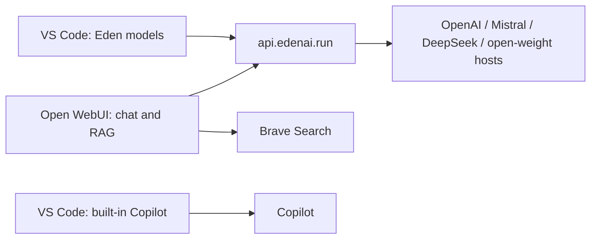

# Eden AI Setup

[Eden AI](https://www.edenai.co/) is the single managed gateway for Open WebUI chat, RAG embeddings, and VS Code custom models. Built-in Copilot and Brave Search remain unchanged. No model proxy is deployed in the cluster.

## Architecture and endpoints



| Purpose | URL |
| --- | --- |
| OpenAI-compatible base URL | `https://api.edenai.run/v3` |
| Chat completions | `https://api.edenai.run/v3/chat/completions` |
| Embeddings | `https://api.edenai.run/v3/embeddings` |
| Public chat catalog | `https://api.edenai.run/v3/models` |
| Public embedding catalog | `https://api.edenai.run/v3/embeddings/models` |

Use the **global** endpoint, not `api.eu.edenai.run`. Eden is a French company, but the global endpoint does not guarantee EU inference or end-to-end EU data residency. The explicit Mistral, Greenference, and Scaleway IDs below advertise EU hosting; DeepSeek advertises Asia and Fireworks advertises the US. Do not configure individual provider keys or BYOK connections.

## Account, keys, and budgets (manual)

1. Create an account in the [Eden dashboard](https://app.edenai.run/), add a payment method, and buy credits.
2. Enable **auto-refill**, choosing a balance threshold and refill amount. Set a monthly refill cap if the account UI provides one. The public prepaid auto-refill documentation does not establish such a cap; do not treat auto-refill alone as a spending limit.
3. Create two production keys, named `openwebui` and `vscode`. Enable **Spending Limit**, set each key's allowance, and select **Monthly** reset. Key budgets are enforced independently; the two keys share the account credit balance. Monthly resets occur on the first day at midnight Europe/Paris time.
4. Store the `openwebui` key as the repository's GitHub Actions secret `EDEN_AI_API_KEY`. Keep `BRAVE_SEARCH_API_KEY` for search. Enter the separate `vscode` key only when VS Code prompts; never put either key in source control or model JSON.
5. Monitor per-key usage in Eden's dashboard. Budget exhaustion or an empty account balance interrupts requests even with the integrations configured correctly.

Eden applies a **5.5% platform fee when credits are purchased**, plus applicable taxes. Allow for that fee when budgeting cash spend. API token prices exclude the fee; long-context/priority surcharges, DeepSeek peak/off-peak pricing, and Mistral Large 4 promotional pricing can change.

Sources: [credit purchases and auto-refill](https://www.edenai.co/docs/v3/general/buying-credits), [monthly key budgets](https://www.edenai.co/docs/v3/general/custom-api-keys), and [pricing](https://www.edenai.co/docs/v3/overview/plans-prices).

## Selected models

The public global catalog was checked on **2026-10-10**. All 13 IDs support function calling. Prices are USD per million uncached input/output tokens, before fees and surcharges.

| Eden model ID | Input / output price | Vision | Context tokens | Hosting / role |
| --- | ---: | :---: | ---: | --- |
| `openai/gpt-6-luna` | $0.10 / $0.50 | yes | 1,050,000 | Everyday chat and light coding |
| `openai/gpt-6.1-sol` | $2.00 / $10.00 | yes | 1,050,000 | Primary coding and reasoning |
| `openai/gpt-6-astra` | $10.00 / $50.00 | yes | 1,050,000 | Hard-task escalation |
| `mistral/mistral-small-2603` | $0.15 / $0.60 | yes | 262,144 | EU; low-cost chat and coding |
| `mistral/mistral-medium-3-5` | $1.50 / $7.50 | yes | 262,144 | EU; coding and multimodal fallback |
| `mistral/mistral-large-4-0` | $0.68 / $2.09 (promo) | yes | 1,048,576 | EU; flagship preview |
| `mistral/zai-glm-5-3` | $1.40 / $4.40 | no | 1,048,576 | EU; coding agent |
| `deepseek/deepseek-flash` | $0.15 / $0.60 (off-peak) | yes | 1,000,000 | Asia; V4.1 Flash reasoning and tools |
| `deepseek/deepseek-v4-pro` | $0.66 / $1.98 (off-peak) | no | 1,000,000 | Asia; text-only reasoning |
| `fireworks_ai/accounts/fireworks/models/minimax-m3` | $0.30 / $1.20 | yes | 512,000 | US; experimental MiniMax M3 |
| `greenference/glm-5.3-flash` | $0.14 / $0.49 | yes | 1,048,576 | EU; experimental GLM tools and vision |
| `scaleway/qwen3.8-27b` | $0.6724 / $3.698 | yes | 256,000 | EU; experimental Qwen |
| `greenference/gemma-4-31b-it` | $0.1485 / $0.42 | yes | 262,144 | EU; experimental Gemma |

The catalog corrects the original MiniMax assumptions: Fireworks advertises **512k context and image input**, not 1M context and text-only input. Live image support still needs a smoke test.

Eden's catalog exposes context lengths but **not maximum output lengths**. With approval, the VS Code configuration uses a conservative **32,000-token output cap for every model**, not a claimed provider maximum. Input budgets reserve those 32,000 tokens within the verified context window. Confirm host-specific output limits before raising these caps; lower a cap if live validation reveals a smaller upstream limit.

The reasoning-effort choices below retain the planned subsets: GPT models use `low`/`medium`/`high`; GLM 5.3 and DeepSeek use `low`/`high`/`max`. The catalog does not publish exhaustive effort options for these IDs, so test them with function calling before relying on them. No effort selector is configured for the remaining models.

## Open WebUI

[Chat values](../applications/chat/values.yaml), the [Secret template](../applications/chat/templates/secrets.yaml), and the [deployment workflow](../.github/workflows/deploy-apps.yml) configure one Eden connection. The `provider-api-keys` Secret's `keys` entry contains just the Eden key, without a semicolon-delimited provider list. Both chat and embeddings reference this Secret.

| Setting | Value |
| --- | --- |
| `openaiBaseApiUrls` | `["https://api.edenai.run/v3"]` |
| `openaiApiKeysExistingSecret` / key | `provider-api-keys` / `keys` |
| `RAG_EMBEDDING_ENGINE` | `openai` |
| `RAG_EMBEDDING_MODEL` | `openai/text-embedding-3-small` |
| `RAG_OPENAI_API_BASE_URL` | `https://api.edenai.run/v3` |
| `RAG_OPENAI_API_KEY` | Secret reference: `provider-api-keys`, key `keys` |

**Embedding ID correction:** Eden requires the provider-qualified `openai/text-embedding-3-small`, rather than the old direct-OpenAI name `text-embedding-3-small`. This is the **same underlying OpenAI embedding model**, not a switch to a different embedding space. Keep the existing vector dimensions (normally 1,536 unless already customized), chunking, and knowledge collections. No re-index is needed when model and dimensions match. Check the returned vector length against the existing index before accepting the cutover. See [Eden's embedding API](https://www.edenai.co/docs/v3/llms/embeddings).

**Persisted settings override Helm defaults.** Back up Open WebUI's database and persistent data before deployment. After deploying, use the admin UI to:

1. Delete the old direct OpenAI/Mistral connections and any legacy proxy connection. Verify a single Eden connection with the base URL above and the `openwebui` key.
2. Update the persisted RAG engine, provider-qualified model ID, embedding base URL, and embedding key to match the table. Leave dimensions and the existing index unchanged; do not trigger a re-index for the provider-prefix change alone.
3. Refresh the model list and verify the selected models are available. Eden's endpoint exposes its full catalog; the VS Code configuration below selects the 13 models explicitly.
4. Verify a normal chat, native multi-turn tool calling, Brave web search, and retrieval from an existing knowledge collection. Use synthetic, non-private test inputs for new API calls.

Brave's `brave_llm_context` engine, native function calling, CORS, secure cookies, signup policy, persistent storage, and websocket/Redis settings are unchanged.

## VS Code

On macOS, back up `~/Library/Application Support/Code/User/chatLanguageModels.json` before replacing the custom providers. The migration creates a sibling `chatLanguageModels.json.pre-eden-<timestamp>.bak` backup and preserves the existing built-in Copilot object and its settings.

Use the following provider array. The `${input:chat.lm.secret.eden-ai-api-key}` placeholder lets VS Code prompt for the separate `vscode` key and store it securely. Do not replace the placeholder with a literal key. If installing this example on another machine, keep that machine's existing Copilot settings instead of overwriting them with the sample.

```json
[
  {
    "name": "Eden AI",
    "vendor": "customendpoint",
    "apiKey": "${input:chat.lm.secret.eden-ai-api-key}",
    "apiType": "chat-completions",
    "models": [
      {
        "id": "openai/gpt-6-luna",
        "name": "GPT-6 Luna",
        "url": "https://api.edenai.run/v3/chat/completions",
        "toolCalling": true,
        "vision": true,
        "maxInputTokens": 1018000,
        "maxOutputTokens": 32000,
        "supportsReasoningEffort": ["low", "medium", "high"]
      },
      {
        "id": "openai/gpt-6.1-sol",
        "name": "GPT-6.1 Sol",
        "url": "https://api.edenai.run/v3/chat/completions",
        "toolCalling": true,
        "vision": true,
        "maxInputTokens": 1018000,
        "maxOutputTokens": 32000,
        "supportsReasoningEffort": ["low", "medium", "high"]
      },
      {
        "id": "openai/gpt-6-astra",
        "name": "GPT-6 Astra",
        "url": "https://api.edenai.run/v3/chat/completions",
        "toolCalling": true,
        "vision": true,
        "maxInputTokens": 1018000,
        "maxOutputTokens": 32000,
        "supportsReasoningEffort": ["low", "medium", "high"]
      },
      {
        "id": "mistral/mistral-small-2603",
        "name": "Mistral Small 4",
        "url": "https://api.edenai.run/v3/chat/completions",
        "toolCalling": true,
        "vision": true,
        "maxInputTokens": 230144,
        "maxOutputTokens": 32000
      },
      {
        "id": "mistral/mistral-medium-3-5",
        "name": "Mistral Medium 3.5",
        "url": "https://api.edenai.run/v3/chat/completions",
        "toolCalling": true,
        "vision": true,
        "maxInputTokens": 230144,
        "maxOutputTokens": 32000
      },
      {
        "id": "mistral/mistral-large-4-0",
        "name": "Mistral Large 4 (Le Chonk)",
        "url": "https://api.edenai.run/v3/chat/completions",
        "toolCalling": true,
        "vision": true,
        "maxInputTokens": 1016576,
        "maxOutputTokens": 32000
      },
      {
        "id": "mistral/zai-glm-5-3",
        "name": "GLM 5.3",
        "url": "https://api.edenai.run/v3/chat/completions",
        "toolCalling": true,
        "vision": false,
        "maxInputTokens": 1016576,
        "maxOutputTokens": 32000,
        "supportsReasoningEffort": ["low", "high", "max"]
      },
      {
        "id": "deepseek/deepseek-flash",
        "name": "DeepSeek V4.1 Flash",
        "url": "https://api.edenai.run/v3/chat/completions",
        "toolCalling": true,
        "vision": true,
        "maxInputTokens": 968000,
        "maxOutputTokens": 32000,
        "supportsReasoningEffort": ["low", "high", "max"]
      },
      {
        "id": "deepseek/deepseek-v4-pro",
        "name": "DeepSeek V4 Pro",
        "url": "https://api.edenai.run/v3/chat/completions",
        "toolCalling": true,
        "vision": false,
        "maxInputTokens": 968000,
        "maxOutputTokens": 32000,
        "supportsReasoningEffort": ["low", "high", "max"]
      },
      {
        "id": "fireworks_ai/accounts/fireworks/models/minimax-m3",
        "name": "MiniMax M3",
        "url": "https://api.edenai.run/v3/chat/completions",
        "toolCalling": true,
        "vision": true,
        "maxInputTokens": 480000,
        "maxOutputTokens": 32000
      },
      {
        "id": "greenference/glm-5.3-flash",
        "name": "GLM 5.3 Flash",
        "url": "https://api.edenai.run/v3/chat/completions",
        "toolCalling": true,
        "vision": true,
        "maxInputTokens": 1016576,
        "maxOutputTokens": 32000
      },
      {
        "id": "scaleway/qwen3.8-27b",
        "name": "Qwen 3.8 27B",
        "url": "https://api.edenai.run/v3/chat/completions",
        "toolCalling": true,
        "vision": true,
        "maxInputTokens": 224000,
        "maxOutputTokens": 32000
      },
      {
        "id": "greenference/gemma-4-31b-it",
        "name": "Gemma 4 31B",
        "url": "https://api.edenai.run/v3/chat/completions",
        "toolCalling": true,
        "vision": true,
        "maxInputTokens": 230144,
        "maxOutputTokens": 32000
      }
    ],
    "settings": {
      "deepseek/deepseek-v4-pro": {
        "reasoningEffort": "high"
      }
    }
  },
  {
    "name": "Copilot",
    "vendor": "agent-host-copilotcli",
    "settings": {
      "openai/OpenAI/gpt-6.1-sol": {
        "thinkingLevel": "high"
      }
    }
  }
]
```

Reload VS Code if necessary, supply the new key, and confirm all 13 Eden models are selectable. Test a multi-turn tool call (including the tool result and follow-up response), reasoning with tools on representative GPT/DeepSeek models, and an image input on a vision-capable model. Use synthetic, non-private prompts and images. JSON validation and public catalog checks do not replace these authenticated tests.

## Cutover and retirement checklist (manual)

1. Create and budget the two Eden keys, then add `EDEN_AI_API_KEY` to GitHub Actions. Preserve old credentials during validation so rollback remains possible.
2. Back up Open WebUI data and VS Code configuration. Publish the changes on a branch and confirm the existing [QA workflow](../.github/workflows/qa.yml) (Helm/chart-testing and Trivy) passes on a pull request. Do not deploy with an empty Eden key.
3. Deploy Chat and Monitoring through [Deploy Applications](../.github/workflows/deploy-apps.yml). Removing the old chart from Git does **not** uninstall an existing Helm release. Updating Monitoring removes the old Grafana dashboard, while Eden provides per-key usage and cost monitoring.
4. Migrate Open WebUI's persisted chat and RAG settings, then pass both Open WebUI and VS Code live checks above, including retrieval from the existing index with unchanged vector dimensions.
5. **Only after the live checks pass**, uninstall the old proxy release:

   ```bash
   helm uninstall litellm --namespace litellm
   ```

   Verify no proxy workloads or ServiceMonitors remain. If its namespace remains, inspect it for unrelated resources before deleting it. Check for orphaned cert-manager certificates/TLS Secrets rather than assuming every generated resource is removed by Helm.
6. Re-run [Deploy Cloudflare Tunnel](../.github/workflows/deploy-cloudflare-tunnel.yml) to apply the removed legacy hostname route in [the tunnel configuration](../infrastructure/cloudflare-tunnel/config.yml). Delete the `llm.lukaswoellhaf.com` CNAME in Cloudflare. These are retirement steps, not prerequisites for testing Eden.
7. Remove obsolete GitHub secrets: `OPENAI_API_KEY`, `MISTRAL_API_KEY`, `DEEPSEEK_API_KEY`, `MOONSHOT_API_KEY`, `LITELLM_MASTER_KEY`, and any Hetzner key. This does **not** revoke the provider-side API keys; revoke those separately after cutover. Keep `BRAVE_SEARCH_API_KEY`.
8. Remove obsolete stored VS Code provider credentials manually if desired. Keep the configuration backup until the migration is verified.

No production deployment, account changes, credential revocations, DNS changes, or Helm uninstall are performed by the local configuration migration.

## Local validation

Restore pinned chart dependencies if missing, then lint and render both charts using placeholders only:

```bash
helm dependency build applications/chat
helm dependency build applications/monitoring
helm lint applications/chat --strict --set apiKeys.edenApiKey=eden-validation-placeholder --set apiKeys.braveSearchApiKey=brave-validation-placeholder
helm lint applications/monitoring --strict -f applications/monitoring/alerts.yaml
helm template chat applications/chat --namespace chat --set apiKeys.edenApiKey=eden-validation-placeholder --set apiKeys.braveSearchApiKey=brave-validation-placeholder > /tmp/chat-rendered.yaml
helm template monitoring applications/monitoring --namespace monitoring -f applications/monitoring/alerts.yaml > /tmp/monitoring-rendered.yaml
trivy config --severity CRITICAL,HIGH --exit-code 0 .
```

Verify chat and RAG both reference `provider-api-keys/keys`, the single Eden URL is rendered, and no provider credentials are in pod environment literals or ConfigMaps. The placeholder necessarily appears in the Kubernetes Secret; never render with production keys into logs or tracked files. Verify the proxy dashboard and ServiceMonitor are absent. Remove temporary render output afterwards.

Search for `litellm`, `moonshot`, `kimi`, `hetzner`, and `llm.lukaswoellhaf.com`. The only remaining matches should be the intentional retirement instructions in this guide. The built-in Copilot provider is outside this model-gateway migration.
